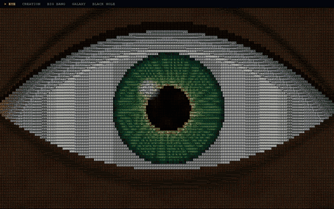

  <picture>
    <source srcset="eye-of-creation.avif" type="image/avif">
    
  </picture>

<h1 align="center">Hi, I'm Onur Demir 👋</h1>

  <b>Full-stack Developer</b> at KodeTrust · Founder of <b>SpandTranslate</b> · Istanbul, Türkiye

  
  
  
  

---

I pick the right tool for each job and deliver end-to-end solutions — web platforms, AI products, dataset building & model training, reverse engineering and automation.

### 🛠️ Tech stack

  
   
  

### 🚀 Featured projects

| Project | What it is | Stack |
| --- | --- | --- |
| [**SpandTranslate**](https://onurdemir.dev/en/projeler/spandtranslate) | Manga & webtoon translation studio — detects speech bubbles and SFX, translates the text and places it back into the page. | Laravel · Vue · Inertia · Tailwind · AI |
| [**SpandZero**](https://onurdemir.dev/en/projeler/spandzero) | Custom detection model trained from scratch — from dataset to training. | Python · Model · Data |
| [**SpandTranslate Desktop**](https://onurdemir.dev/en/projeler/spandtranslate-desktop) | Windows app that runs translation on the user's own hardware; files stay local, with a secure bridge to the account. | Model · JavaScript |
| [**GT111A Camera Root & De-Cloud**](https://onurdemir.dev/en/projeler/gt111a-root-decloud) | Reverse-engineered a Wi-Fi camera whose cloud was shut down — network root, open-source RTSP/PTZ/web live stream with no cloud. | Python · Linux · Hardware |
| [**ReviewVega**](https://onurdemir.dev/en/projeler/reviewvega) | NFC & QR review cards on restaurant tables, connected to a business panel. | Laravel · Vue · Inertia · Tailwind |
| [**SpandToon**](https://onurdemir.dev/en/projeler/spandtoon) | Manga & webtoon site infrastructure. | Next.js · React · Tailwind · MySQL |

<a href="https://onurdemir.dev/en/projeler"><b>→ See all projects on onurdemir.dev</b></a>

### 🔭 Currently

- 💼 Full-stack Developer at **KodeTrust**
- 🌐 Building **SpandTranslate** — AI-powered manga & webtoon translation
- 🎓 Studying Computer Programming at **İstanbul Aydın University**
- 🤝 Open to freelance & project-based work — remote or in Istanbul

---

Header animation: <a href="https://github.com/byk1lla/eye-of-creation">Eye of Creation</a> by byk1lla — ASCII cinematic loop in Python + pygame.
